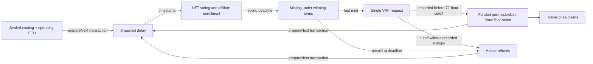

# V12: deadline voting and onchain seasons

Implementation record: 2026-10-22. **New local source, not a deployed upgrade.** Existing V8–V11 contracts, frozen terms, registries, metadata and exports retain their actual behavior. V12 must be deployed as a new protocol after review and a Sepolia rehearsal.

## What depended on Web2

Before this change, collections already held mint receipts, enforced per-wallet mint limits, generated permanent SVG/metadata, verified Chainlink VRF, allocated prizes and paid claims/refunds onchain. However, Launch/database drafts and the durable season worker chose the next collection, prepared/deployed it, admitted affiliates through signed permits, scheduled enrollment/opening, activated sales, and coordinated announcements. An owner activation transaction and worker timing could prevent a planned opening. Historical indexer/database projections also supplied the public site's collection list. X failures had previously interrupted season operations.

V12 moves the authoritative catalog, sequence, economic choices, ownership snapshots, ballots, opening conditions, eligibility, settlement and reserves into contracts. The new website routes read these contracts directly. The old database/indexer and worker remain for historical collections; they are not authorities for V12. No hosted migration is necessary for the direct-chain routes.

## Contract map

| Component | Responsibility |
| --- | --- |
| `ManekinekoSeasonControllerV12` | Sealed ordered catalog, immutable operating policy and option packages, deterministic next-collection preparation, separate operating ETH |
| `ManekinekoVotingV12` | Timestamp ownership checkpoints, bounded ballots, legacy NFT escrow, onchain affiliate eligibility |
| `ManekinekoRoundV12` | Deadline sale, permanent NFTs, fixed economics, affiliate allocation, VRF, draw, claims, refunds, operator reserve |
| `ManekinekoRoundDeployerV12` | Immutable round creation code split across inert storage contracts to respect EIP-170 |
| `ManekinekoWinnerCreditsV8` | Preserved lifetime sponsored-reward history, V12 registration/redemption, sponsorship locked during voting/minting |
| Existing `ManekinekoRendererV11` | Reused original renderer and unique-rank-v6 algorithm; this is not relabeled as a new artwork version |

The controller has no upgrade, pause, replacement-catalog or policy-edit API. Before sealing, the operator uploads the already planned identities, approves the reviewed controller in Credits V8, binds its deployer, and optionally registers historical voting sources. Sealing permanently closes these catalog and source setup paths. All 22 Mainnet seasons / 216 collections fit within the 256-item catalog limit. Each season is contiguous and contains at most 10 collections.

## State transitions and signatures



- **Between collections:** the operator can use Launch `/dashboard` to fund and call `prepareNext`. Anyone may submit this deterministic transaction. It succeeds only after the preceding draw is final and liabilities remain backed, or refunds unlock after unsold expiry or the fixed randomness timeout. Claims/refunds do not all have to finish. Waiting for the draw ensures the preceding collection can qualify at the next snapshot.
- **One signature after a sellout:** the fixed operator can call `settleAndPrepare(expectedRoundId, expectedOperatorProceeds)` after verified randomness arrives. It finalizes the same bounded draw, transfers only the remaining ordinary 20% to the fixed operator, then prepares the next catalog entry. If any step fails, all steps revert. An exact optional ETH top-up supplies any operating-budget shortfall separately from mint reserves. Stale round IDs or changed proceeds revert. On the final catalog entry it settles without creating another collection. `prepareNext` also accepts attached operating ETH, allowing one transaction after either refundable outcome. A timed-out sold-out collection has zero operator proceeds. If the operator batch finalizes, its separate execution reward is also paid to the operator; ordinary proceeds remain exactly 20%.
- A preview checks whether the next eight deterministic draw attempts can finalize. If they cannot, Launch offers permissionless draw progress first; it does not silently change the algorithm or repeat an atomic transaction that would roll progress back. Individual finalization, preparation and withdrawals remain available. Optional reserve recoveries are separate transactions.
- Preparation atomically deploys, registers and funds the next collection, and publishes its vote start/end. A failed preparation publishes no schedule. The vote starts after an immutable delay of 60 seconds–1 day; its duration is 1 hour–7 days, both configured at controller deployment.
- **At the vote deadline:** the winning terms are final and mint transactions become valid. No finalize-vote, activate-sale, owner approval, database update, X post or successful website visit is required. A block at exactly the deadline rejects votes and permits mints.
- **While live:** no account can pause, cancel, change terms, upgrade, move the deadline, replace the coordinator or remove the live VRF budget. `cancelExpiredRound` only records an already refundable outcome; it is not an emergency stop.
- The final mint attempts the single VRF request. A request that reverted entirely may be retried by anyone. After a successful request there is no reroll, replacement request or owner override. An immutable 72-hour cutoff from sellout provides the terminal missing-randomness refund path described below. The coordinator callback stores entropy only; `finalizeDraw(1..8)` performs bounded deterministic work, callable by anyone.
- **Refund timing:** unsold collections refund at their mint deadline. Sold-out collections refund at `soldOutAt + 72 hours` only if no valid randomness was recorded strictly before that timestamp. The timestamp itself fixes the outcome; no owner/cancellation/refund transaction is needed to enable claims. A matching late callback emits `LateRandomnessIgnored` and returns without recording entropy. At the exact cutoff it is already too late. Retrying an unaccepted request or adding funding never extends the cutoff.
- **After on-time entropy:** finalization stays permissionless indefinitely. No deadline, owner signature or cancellation can discard recorded results. `finalizeDrawAndClaim(recipient)` processes the same bounded algorithm and pays the successful caller's executor reward from separate operating ETH. `finalizeDraw` records a pull-claimable reward so a rejecting payment recipient never prevents others from settling. A progress-only call does not earn a reward.
- **Funded execution:** every preparation reserves an additional 0.01 ETH in its round. Anyone may add more through `fundExecution`; the reserve cannot be withdrawn while the round is active. It pays exactly once to the successful finalizer (the fixed operator for the controller batch). If the collection refunds, the operator can recover only this separate unused budget. Protected mint liabilities never pay an executor. The optional independent executor polls verified contract state and needs no operator key or website; see [failure policy and executor runbook](v12-draw-failure-policy-2026-10-22.md).
- Launch and public Collections show voting/mint/randomness countdowns, the absolute cutoff, draw stage, refund reason and executor funding. Zero on a cached timer says a fresh contract check is required. Recorded-entropy states explicitly say results cannot expire. VRF/network availability, transaction inclusion and economic executor incentives remain liveness assumptions; the implementation does not promise self-running contracts or an active hosted executor.

Ethereum contracts execute through transactions, not wall-clock callbacks ([Ethereum documentation](https://ethereum.org/developers/docs/smart-contracts/)). “Onchain” here means authoritative rules/state/settlement, not a guarantee of transactions occurring without senders. Chainlink remains an external randomness service with onchain proof verification. Its [security guidance](https://docs.chain.link/vrf/v2-5/security) informs the single-request and entropy-only callback design. The frontend offers optional WebSocket block notifications and HTTP polling fallback; neither controls validity.

## Voting policy

Each ballot offers 1–8 complete economic packages, committed in the controller before the catalog is sealed. The operator cannot replace options during later ballots. This first implementation uses the same reviewed menu throughout the sealed catalog. It does not implement user-authored proposals or arbitrary governance execution.

| Parameter | Enforced boundary |
| --- | --- |
| Mint price | **At least 0.01 ETH**, divisible by 10,000 wei; multiplication by supply must not overflow |
| Supply | **1,000–65,536**, chosen by voting for each collection and fixed when minting opens |
| Winning NFTs | 1–10, with 6,000 basis points exactly divisible by the count; 7 and 9 are excluded |
| Mint duration | 1–24 hours |
| Fixed allocations | 60% prizes / 20% affiliates / 20% ordinary operator proceeds; not ballot options |
| Other fixed rules | 20 cumulative primary mints per recipient, 20 per batch, 10 affiliate positions, one attributed paid mint to qualify |

Supply is elastic between collections: voters select a package with the desired supply for that ballot. Once voting ends, nobody can expand or shrink that live collection. The 65,536 ceiling preserves the existing permanent four-number identity space. The 1,000 supply floor and 0.01 ETH price floor imply at least 10 ETH of mint revenue **if sold out**. Ordinary operator proceeds are always 20% of that revenue, before execution costs; 2 ETH is the minimum-term sellout example, not a fixed payment or cap. An unsold collection refunds holders and yields no operator mint proceeds. A sold-out collection that times out without recorded randomness also refunds and yields no operator mint proceeds.

Voting uses **one vote per eligible NFT**, held at timestamp `startsAt - 1`. V12 checkpoints every mint, transfer and burn. Only previously successful, revealed, fully backed official collections qualify; failed/refundable collection tickets do not. Each wallet can consume a source collection's snapshot balance once per ballot, in batches of at most 16 sources. Source groups can be voted in separate transactions; all NFTs within one source group receive that choice. A transfer or flash loan after the snapshot cannot give the new holder another vote. NFT-based voting is deliberately not one-person-one-vote.

The option with the most votes wins. Equal vote totals choose the lowest option index. No votes select option zero, the published fallback. There is no turnout threshold that can stall opening. The UI labels pre-deadline economics as the leading option; `mintQuoted` binds payment to the final terms hash.

Old NFT contracts cannot be retrofitted with historical ownership checkpoints. Eligible historical holders must approve/deposit NFTs in the new voting vault **before the snapshot**. They can withdraw at any time; past voting weight stays with the snapshot holder and cannot be reused by a new depositor. Unclaimed winning NFTs retain their original transfer locks and must settle their prize before entering escrow. Historical sources are independently registered and pinned through Credits V8 before the catalog is sealed. A genuinely fresh genesis may explicitly enable the existing first-collection no-NFT affiliate exception; migrations cannot combine that exception with imported sources.

## Exact funds and preserved rules

All mint receipts remain wholly reserved until draw finalization; unsold expiry or missing-randomness timeout leaves them reserved for full mint-price refunds to current NFT holders. Refunds burn the ticket; they do not restore cumulative primary mint allowance or lifetime sponsorship eligibility. No operator or affiliate mint proceeds vest on a refundable collection.

Sellout fixes the affiliate shares. After on-time randomness and successful finalization:

- 60% is divided into the configured number of exactly equal prizes. Winners are distinct NFTs, not necessarily distinct wallets. The current winning NFT holder claims each rank. Unclaimed winning NFTs remain transfer-locked. Permanent numbers/artwork never become score or prize overlays.
- 20% is divided equally among enrolled affiliates with at least one attributed paid mint. If three qualify out of ten positions, each receives `floor(affiliatePool / 3)`, regardless of referral count. Direct/self referrals do not qualify; self-referral mint calls revert. An affiliate can claim after draw finalization without waiting for prize holders. The later vesting protects 100% refund solvency until successful settlement.
- Exactly 20% is ordinary operator allocation. The immutable operator wallet can call `withdrawOperator` after reveal, up to the remaining allocation and only from unprotected balance. Donations do not enlarge this allocation.
- V11's separate growth-reserve rule is preserved: division dust or a pool with **zero qualifiers** is a separately visible unused affiliate reserve. Only that reserve can be withdrawn through its own post-reveal method. It never absorbs a qualifying affiliate's entitlement.

Example: 1,000 mints × 0.01 ETH = 10 ETH. Six prizes are 1 ETH each; three qualified affiliates receive 0.666666666666666666 ETH each, with 2 wei in the separate reserve; ordinary operator proceeds are 2 ETH.

At 2,000 mints × 0.01 ETH = 20 ETH, the same percentages allocate 12 ETH to prizes, 4 ETH to affiliates and **4 ETH to the operator**. Voting for a higher price also scales all three allocations proportionally.

VRF funds, sponsorship and the executor reward come from separate prefunded operating ETH, not protected mint receipts. VRF recovery is allowed only after entropy arrives or refunds unlock, and the coordinator may still refuse recovery while a request is pending. A stuck VRF subscription never blocks holder refunds or next preparation. V12 sponsorship cannot be withdrawn during voting or minting. Later sponsored mints pay the full price and use the same round caps and reserve accounting. Credits V8 preserves the previous registry's lifetime-use chain; an award settled before a target's sale opening may redeem there even if that target was prepared before the prize claim. A shortage of sponsorship leaves the reward unconsumed until a funded later opportunity.

## Website and X

- `/vote`: onchain options/totals/deadline, snapshot voting in bounded source groups, legacy escrow controls.
- `/collections`: collection navigation, quoted minting and referral URLs, affiliate enrollment/claim, holder prize claims, ticket refunds, lifetime sponsored redemption.
- Launch `/dashboard`: pending preparation/funding, fixed operator withdrawal, separate growth/sponsorship/VRF recovery and permissionless draw actions, beside a searchable season/collection tree read from the controller. A failed draw request exposes exact-amount funding review. Mainnet and Sepolia use independent deployment pins. There is no login, database editor or worker control page.
- Reads are pinned to one block; unavailable/stale data disables writes. Controller runtime and network are pinned, and the selected wallet RPC independently checks controller/dependency/round bindings before signing. Pending transaction intents/hashes persist locally; unknown submission outcomes are not automatically retried. No website private signing key exists.
- Retired Web workflow routes (including `/seasons`, `/history`, `/prizes`, `/mint`, `/my-nfts`, NFT detail and `/operations`) redirect to `/collections`. Retired Launch routes redirect to `/dashboard`. Their old HTTP APIs return 410; historical `/api/nfts/[collectionId]/[tokenId]` remains for metadata compatibility. Older source adapters/tests are retained for immutable history, not exposed as active workflows.
- The shared `packages/protocol` layer verifies state and transaction intent in both apps. Per-wallet browser locks and a durable nonce-bound journal prevent duplicate prompts and preserve uncertain submissions across reloads. Uncertainty requires receipt reconciliation; it does not invite an automatic retry.
- With no deployment pins, Launch shows the checked-in catalog as **Not deployed** and no executable queue. Once configured, the entire tree comes from the controller at the snapshot block. Earlier prepared collections are labeled for settlement inspection, not falsely marked paid. Landing reads `/api/protocol/status`, a verified read-only projection, and its 60/20/20 examples are labeled illustrative.

`scripts/protocol-v12/social.ts` is a separate one-way observer/outbox. It reads finalized blocks, detects preparation, voting/opening deadlines, sellout, missing-randomness refunds, recorded randomness, reveal and completed prize claims, and keeps durable deduplication keys. A deadline event is derived from finalized contract timestamps even if no transaction emits a log at that instant. Historical catch-up posts use past tense and link to current status. Posting and read-only observation are separate commands. X errors or ambiguous delivery leave a reconcileable outbox entry and have **no path to pause contracts**. Separate Mainnet/Sepolia credentials and the expected X account ID are mandatory. No X post was sent during implementation.

## Deployment and migration sequence

1. Review the new contracts and economic option packages. Commission an independent security review before Mainnet funds. Verify real current VRF lanes, confirmations, gas and funding against the intended network; local mock success is not live VRF evidence.
2. Reconcile the checked-in catalogs against saved season plans, including stable IDs, symbols, exact names, order and colors. The October 22 read-only staging export failed with SQLSTATE 53000, and an older local backup has differing IDs. Do not upload/seal a migration catalog until that discrepancy is resolved; do not overwrite saved IDs. The new Sepolia V12 planning catalog is independent of existing V10 mock drafts. `scripts/protocol-v12/prepare.mjs` validates these against the Mainnet catalog or the independent Sepolia identities, and emits offline catalog-upload calldata. It refuses network relabeling and never reads database credentials or broadcasts transactions.
3. Freeze/retire old sponsored mint destinations and verify zero sponsorship throughout the preserved registry ancestry. Deploy Credits V8 with the verified previous registry and unchanged historical proof root. A zero previous registry is for genuinely new deployments only; it must not reset existing lifetime history.
4. Deploy the controller with operator, Credits V8, VRF pins/budgets, voting delay/duration, genesis policy and reviewed options. Deploy its V12 round deployer, verify all runtime/code-store dependencies, bind it, and approve the controller's exact deployed code hash in Credits V8. Register canonical historical collections/sources when migrating. Approve every reviewed factory needed by this registry, then irrevocably call `sealFactories()` before `sealCatalog()`; ownership transfer cannot reopen the factory set. Bootstrap mode is refused with declared ancestry, a historical winner root, or registered historical collections at sealing.
5. Upload the catalog batches. Compare every onchain identity and option against the reviewed export. Only then seal. Fund operating ETH and call `prepareNext`. The first vote deadline is created by this transaction; there is no uncommitted calendar opening promised before it.
6. Rehearse a sellout, unsold refund, missing-randomness refund, late callback, independent funded finalization, a later-season opening, three qualifying affiliates, multiple winning NFTs held by one wallet, snapshot transfers, legacy escrow, sponsorship, operator recovery, RPC outage and X outage on Sepolia. Do not reuse Mainnet artwork identity as a fictional test season.
7. Configure Web and Launch deployment pins/endpoints in their `.env.example` files, independently verify hosted wallet behavior, and start the read-only observer. Enable X delivery only against the reviewed network account. Retain historical contracts and claims indefinitely.

Local commands:

```sh
npm run contracts:test
npm run v12:deploy:local --workspace @manekineko/contracts
node scripts/protocol-v12/prepare.mjs input.json output.json
npm run protocol:v12:test
npm run protocol:v12:social -- config.json state.json --observe
```

`v12:deploy:local` requires a disposable running chain 31337 and refuses public networks. It uses three explicitly fictional collections. The preparation input has `{chainId, controller, options, plans}`; options use decimal-string `supply`, wei `price`, `winners`, seconds `duration`, while `plans` are existing saved Launch plans. Output files are exclusive-create. It prepares catalog calldata, not an authorization to deploy or seal.

The social config is `{chainId, controller, controllerCodeHash, rpcUrl, appUrl, xAccountId}`. Keep state and its lock on durable private storage. `--observe` only queues; `--publish` delivers up to five pending entries. A crash leaving a lock or an `intent`/`uncertain` entry requires checking X before retrying. `--reconcile eventKey postId` verifies author, exact text and attached media. An unresolved intent blocks all later publishing. Unsent entries can refresh to the current template; sent/uncertain evidence is immutable. Images use approved Ligature/Open branding on Mainnet and visible Sepolia test labeling. See the [architecture/security review](v12-architecture-security-review-2026-10-22.md) for findings and offline preview commands. Credential prefixes are `V12_MAINNET_X_` / `V12_SEPOLIA_X_`, followed by `API_KEY`, `API_KEY_SECRET`, `ACCESS_TOKEN`, `ACCESS_TOKEN_SECRET`. This worker has no chain signing key.

## Verification boundary

See the [implementation verification record](v12-implementation-verification-2026-10-22.md) and subsequent [operator interface handoff](v12-operator-interface-2026-10-22.md) for actual check counts. Source tests cover the live-sale authority boundary, deadline equality, immutable terms/floor, treasury solvency, equal affiliate distribution/dust, full refunds, single VRF request, snapshot transfer/escrow replay, tied/no-vote fallbacks, sponsorship lock, lifetime rewards, catalog progression and EVM size limits. Browser specimens use isolated RPC responses; they do not establish connected production-wallet behavior or live oracle delivery.

No hosted database write, public-chain transaction, deployment, X publication, Git push, or historical-contract upgrade is part of this local implementation. The old deployed system remains in force until a separately verified rollout.

## Missing-randomness security tradeoff

The fixed timeout deliberately prioritizes bounded holder access over waiting forever for VRF. It is an application outcome cutoff after a single accepted request, with no alternate seed. Chainlink warns against cancellation/re-request designs because a party can discard unfavorable randomness. A fixed timestamp removes operator discretion and transaction-order races after the cutoff, but **does not eliminate oracle withholding or sustained validator censorship before entropy is recorded**. It must not be marketed as proving unbiased completion under those failures. Independent review of this availability/fairness tradeoff and a live Sepolia rehearsal are required before Mainnet; source tests are not an audit. See the [policy record](v12-draw-failure-policy-2026-10-22.md).

## Material-risk remediation follow-up

See [the current Mainnet readiness record](v12-mainnet-readiness-2026-10-22.md) for the user-accepted open NFT and 72-hour policies, complete deployment verifier, bounded recovery executor, audit packet and unresolved deployment evidence. The executor budget is separate from mint receipts and does not change 60/20/20 or require additional routine operator signatures between collections.
