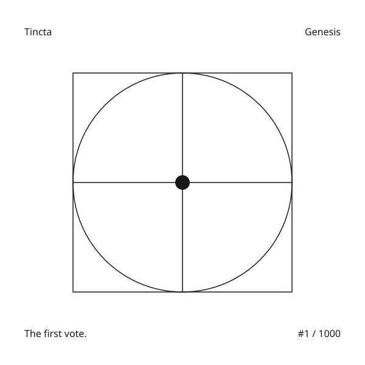

# V14 Genesis free mint

V14 is deployed on **Sepolia**. See the [October 26 release record](sepolia-v14-release-2026-10-26.md) and [public manifest](deployments/sepolia-v14-2026-10-26.json) for exact source proofs, finalized runtime checks and Genesis dates. The user authorized the [Genesis-first buyer rehearsal](sepolia-v14-buyer-rehearsal.md). The old V13 run remains paused; X delivery and Mainnet remain inactive. Dated local validation sections below describe earlier snapshots, not current release status.

The user stopped the V13 rehearsal before its first participant transaction and selected **one free primary mint per wallet, 1,000 NFTs total, and a 24-hour window**. This document describes a new graph; it does not upgrade or relabel the existing V13 graph.

## Approved artwork



The approved monochrome artwork places a single black point at the center of a circle, square and crossing axes. “The first vote.” identifies its purpose; the token number identifies each NFT. The image and metadata are generated entirely by Solidity. Web, the public voting guide and both Tincta landing pages reuse the same exported NFT #1 preview through `packages/ui/src/genesis-artwork.tsx`. Contract tests compare the preview against the actual token URI.

The adjacent copy always explains that Genesis applies only to the first paid vote. Later votes require NFTs from successfully revealed paid season collections. The preview is not evidence of a Mainnet launch.

## Rules

Tincta Genesis opens when the operator seals the new paid catalog. Its nonpayable `mint()` costs zero ETH; the caller pays network gas. Anyone can mint to their own wallet while the window is open, up to the total cap. The one-mint flag is lifetime and does not reset after transfer. Received NFTs do not consume a recipient's primary mint. This is a wallet limit, not proof of one person per mint. No admin mint, configurable price, extension, pause or upgrade exists.

The full 24-hour window must end before anyone can prepare paid collection 1, even after an early sellout. The normal configured voting delay then allows ownership to settle before the first snapshot. There is no minimum Genesis turnout: an empty free mint does not permanently lock the catalog, and an empty paid ballot retains the published option-one fallback.

Each Genesis NFT held at the timestamp immediately before the first paid ballot opens contributes one vote. Transfers before the snapshot change the eligible holder; transfers afterward create no extra vote. Each holder/source balance may vote once. **Both used and unused Genesis votes expire after paid ballot sequence 1 globally.** Genesis does not qualify for collection 2 or for the first collection of any later season. Later ballots use successfully revealed paid NFT sources as before.

Genesis is outside all paid seasons: no paid round ID, season membership, VRF draw, refund, prize, affiliate eligibility, sponsored mint credit, holder-pool contribution or holder claim. Its onchain SVG/metadata describe a free collectible, never a paid draw ticket. Existing explicit first-paid-ballot no-NFT affiliate bootstrap policy remains independent; Genesis does not create an extra affiliate pathway.

Paid collections retain the **60% prizes / 20% qualified equal affiliates / 10% season holders / 10% treasury** split, cumulative 20 primary mints per recipient, full mint-price refunds for unsold expiry or missing randomness, and current-owner claims. Once a collection becomes refundable, refunds never expire and unclaimed principal stays reserved, including after later collections or seasons begin. Free NFTs do not dilute the season pool or its first-5% claim coverage.

## Exact component lineage

| Component | Version |
| --- | --- |
| Controller | `ManekinekoSeasonControllerV14` |
| Voting checkpoints and ballots | `ManekinekoVotingV14` |
| Free ERC-721 | `ManekinekoGenesisV14` |
| Paid round and deployer | Existing V13 templates, deployed fresh for this graph |
| Holder rewards | Existing V13 template, a fresh pool bound to the V14 controller |
| Winner credits | V9, a fresh independently sealed registry |
| Paid NFT renderer | V11 |

The V14 controller creates voting and the paid renderer, then binds a separately deployed Genesis NFT once, before sealing. Voting records Genesis ownership checkpoints but excludes Genesis from ordinary eligible-source and affiliate paths. The controller binds the deployer and holder pool and preserves catalog names, order, IDs and colors. Existing frozen V13 manifests, addresses, deadlines and financial behavior are unchanged.

## App and operations support

Web shows the free mint before any paid round exists, with exact price, supply, wallet limit, UTC opening/closing dates, connection state, used-mint state and closed/sold-out state. Its review builds a zero-value transaction from fresh data, checks the contract binding/runtime on both RPC providers, then revalidates after confirmation. A changed state, wrong pin, wrong network or unresolved wallet intent disables signing. Genesis becomes the first source group in ballot 1 and disappears from later source lists.

Launch shows the free window and withholds preparation until its deadline. The normal permissionless preparation transaction then starts the first paid ballot. V14 social and draw-executor entry points verify the V14 graph and preserve actual paid-component versions; the draw executor stays idle during Genesis. These entry points were not run against Sepolia. The paid lifecycle observer does not publish a Genesis announcement; a launch announcement/image remains separate review work before any X delivery.

Public docs and both landing pages show the exact approved Genesis artwork, first-ballot-only voting and Sepolia testing status. Mainnet minting has not launched. The V14 release connects the new verified graph while preserving historical V13 manifests and refund access. Partial V14 public configuration fails closed instead of falling back to an older graph.

For Web and Launch, set the complete network-scoped `NEXT_PUBLIC_V14_SEPOLIA_` group only after deployment verification: `CONTROLLER`, `CONTROLLER_CODE_HASH`, `HOLDER_REWARDS_CODE_HASH`, `GENESIS_CODE_HASH`, and public `RPC_URL`; `WS_URL` is optional. Mainnet has its own empty `MAINNET_` group. Web also requires the complete generic `NEXT_PUBLIC_V14_` group, including `CHAIN_ID`, because its default participation route uses the configured default network. Do not copy old controller addresses into these fields.

## Commands and deployment boundary

- `npm run protocol:v14:test` exercises the production contracts on a disposable local EVM, including free mint, first voting, a sold-out draw, an unsold refund, later paid-holder voting and holder rewards.
- `npm run v14:deploy:local -w @manekineko/contracts` refuses public chains. It opens the local Genesis window but does not skip it or prepare a paid round.
- `npm run protocol:v14:verify -- expectation.json report.json` performs no blockchain writes, publishes Solidity sources to Etherscan, and requires `ETHERSCAN_API_KEY` plus `V14_VERIFY_RPC_URL` and `V14_VERIFY_SECONDARY_RPC_URL` from independent hosts. Its expectation includes `genesis` and `genesisCodeHash`, the complete catalog/options/settings, all normal component pins and the registry creation transaction. It compares compiled runtime and immutable values for every component, checks Genesis bindings and 24-hour policy, verifies that paid ballots cannot overlap Genesis, and checks all paid reserves and holder accounting.
- `UI_BROWSER=opera npx playwright test tests/visual/v14-genesis.spec.ts --workers=1` uses an isolated Opera profile with synthetic RPC/wallet fixtures. It never accesses the user's Opera wallet profile or Google Chrome.

`npm run protocol:v14:deploy:sepolia` deploys the reviewed fresh graph with a durable private journal and capped gas, publishes all seven executable components, then seals the catalog to open Genesis. A finalized two-RPC release report is required before app pins are enabled. The authorized live rehearsal uses a fresh reviewed manifest/bundle, Genesis mints, the real 24-hour wait, first-ballot Genesis votes and the original recovery-address and budget protections. The V13 buyer bundle is pinned to the old graph and must not be reused by editing its manifest. Do not restart the paused V13 launcher.

## V13 pause and funds

At Sepolia block **11991768**, immediately after stopping the launcher, bank `0xC51c9c66997740523F8c85D0336267919F32539C` held **20 Sepolia ETH**, with nonce 0 and zero rehearsal journal transactions. The prepared V13 Aster Atlas had zero mints and zero affiliates. The process was stopped before its runner began; a private `PAUSED-BY-USER.json` marker records the stop. No funds were returned or spent during this V14 implementation.

The deployed V13 contract has no pause switch. Its immutable ballot and mint deadlines continue independently. Stopping the process stops automation; it cannot freeze onchain time or prevent an independent public participant from transacting. This dated balance observation is not a claim about later chain state.

A follow-up read during implementation at block **11991868** again confirmed **20.0 Sepolia ETH and nonce 0**.

The original final recovery destination remains `0xC0Eb929903dCD29c7a33E6dA1f78a247CFB68145`. The initial 20 ETH observation predates the subsequently authorized V14 rehearsal. That new run adopts only the authenticated encrypted wallets after confirming the historical run has zero transactions and empty buyer balances. Network gas cannot be recovered; any future reconciliation must distinguish gas spent, liquid balances and contract-locked liabilities.

## Historical pre-release verification record

See the final section below for commands actually run and evidence boundaries. Local tests and synthetic Opera wallet rejection are not live wallet signing, hosted deployment, independent security audit, real Chainlink completion or Sepolia rehearsal completion.


Checks completed on this local worktree:

- V14 + V13 contract suites: **28 passing**, including the new Genesis lifecycle and the existing financial regression suite. The V14 suite uses the production bytecode and a local VRF mock; no real Sepolia signer is used.
- Protocol worker/unit suite: **28 passing**. Genesis configuration and docs checks: **7 passing**. Visual source policy: **10 passing** plus the source-policy scan.
- Contracts, Web, Launch, Landing and protocol-worker TypeScript checks passed. The isolated Web, Launch and Landing production fixtures built successfully. These fixture builds are not a hosted application release.
- ABI/source exports fit both Ethereum runtime and initcode limits: controller 13,877 / 40,468 bytes; voting 9,388 / 9,630; Genesis 6,911 / 8,095 after the October 26 artwork refinement.
- Local Opera browser suite: **13 passing**. Checks use synthetic read-only RPC fixtures and a wallet that rejects signing. They cover mobile/tablet/desktop layout at 320, 390, 768, 1280 and 1440 px, accessibility scans, wrong-pin error/retry, lifetime mint limits, closed/sold-out mint states, first-ballot source discovery, zero-value transaction review, rejection and deadline changes during review. Desktop and mobile screenshots were visually inspected.

Browser evidence: `test-results/v14-genesis-1440-opera.png`, `test-results/v14-genesis-390-opera.png`, `test-results/v14-operator-1440-opera.png`; traces/video and results are under `test-results/visual/`. These are generated local artifacts, not committed baselines. Other browser engines, real mobile devices, screen-reader review, 400% zoom, every loading/transition breakpoint, hosted pages and real connected-wallet signing remain unverified. No CI job was run remotely and no public-chain write was performed for V14.

## Source publication is a release gate

The October 26 follow-up makes `protocol:v14:release-check` (also `protocol:v14:verify`) fail unless source and ABI are publicly readable, with exact verification evidence, for the controller, voting ledger, Genesis, renderer, credits registry, holder vault, deployer and **every prepared paid collection**. The library `verifyDeployment()` remains a read-only runtime check for local tests and workers; its result alone is not the public release certificate. Runtime pin verification shown in the app is now labeled “Contract state checked” to distinguish it from explorer source publication.

The publisher takes the complete Solidity Standard JSON input from the artifact's original Hardhat build-info, with its compiler version, optimizer, via-IR, imported dependency sources and constructor encoding. It never flattens or recompiles a historical deployment with new comments. New V14 contracts have plain-language NatSpec explanations of setup, the fixed 24-hour window, primary mint limits, transfer snapshots, ballot sequence, escrow, paid accounting separation and metadata. Existing V13 financial templates retain their already documented original source and version.

Submission GUIDs and bounded retries are saved in a private journal next to the requested report. A successful submission, “already verified” string or similar-bytecode match alone cannot pass: the final API read must return the actual source and ABI for this address, with matching compiler, contract name and constructor arguments. Failed/pending publication exits nonzero and produces no ready report. If Etherscan automatically inherits a Similar Match, the gate additionally requires Sourcify’s exact creation and runtime match, exact original source, compiler, contract identity, chain/address and constructor arguments. The release report identifies `etherscan-exact` versus `sourcify-exact` and links both the readable Etherscan code and the exact proof. A Similar Match alone remains a failure. This follows [Etherscan’s documented Similar Match limitation](https://info.etherscan.com/update-on-similar-match-contract-verification/) and [Sourcify’s public verification API](https://docs.sourcify.dev/docs/api/).

Resume with the same output path and original build. Preserve a rejected journal for diagnosis; do not replace compiler input to silence it.

Future release procedure:

1. Deploy the reviewed graph with the original compiled artifacts; retain build-info and all constructor inputs. Publish individual deployed components before opening the immutable free window where possible. Binding and catalog sealing start the real 24-hour clock; explorer delays cannot pause it.
2. Run `npm run protocol:v14:release-check -- expectation.json private-report.json`, with both independent `V14_VERIFY_RPC_URL` / `V14_VERIFY_SECONDARY_RPC_URL` endpoints and `ETHERSCAN_API_KEY` provided privately. The command verifies finalized runtime/immutables/accounting, publishes missing source, polls acceptance and reads back public code. It rejects a report if another collection was prepared during publication.
3. Only enable app deployment pins after the report contains `independentRpcAgreement: true` and `explorerSourcesPublished: true`. This gate does not deploy apps, seal a catalog, prepare a round, launch X delivery or certify an independent audit.
4. For future collection preparation, configure `npm run protocol:v14:sources -- expectation.json private-publication-directory --watch` alongside operations. It detects changed collection counts and invokes the same full release gate, saving one report per count. `--once` performs one check. It has no signer, private key or transaction capability. It stops on mismatch or incomplete publication so a supervisor can flag the failure and resume from the durable journal. The rehearsal supervisor starts this service alongside the buyer runner. It discovers public permissionless preparations after confirmation; Etherscan verification cannot be atomic with an EVM deployment or alter its fixed voting deadlines.
5. The two STOP-prefixed CodePart addresses store exact paid-round creation bytes. They are byte storage rather than ordinary Solidity executable runtimes; the full-graph verifier checks every byte and the public deployer/round sources explain their construction. They are not falsely labeled explorer-verified contracts.

Reference: Etherscan's [source submission API](https://docs.etherscan.io/api-reference/endpoint/verifysourcecode) and [public source readback API](https://docs.etherscan.io/api-reference/endpoint/getsourcecode).

### Existing V13 collection repair

On October 26 (Asia/Shanghai), Aster Atlas at `0x210c13D0bc8300236d865E8A6987650725C8caaA` was confirmed unverified, then published with its original V13 compiler input. The complete original graph matched two independent RPCs at finalized block 11991917. Etherscan subsequently returned exact matching source, constructor arguments, compiler and ABI. [Read its public code](https://sepolia.etherscan.io/address/0x210c13D0bc8300236d865E8A6987650725C8caaA#code). No transaction was signed; the bank and rehearsal were not operated.

## October 26 presentation and artifact follow-up

The first participation region uses a `100dvh` minimum (`100vh` fallback) in loading, error, empty and populated states. Content grows when necessary for a narrow screen or larger text; there is no fixed-height clipping or nested scrollbar. The status message is centered and the lower navigation is reserved at the bottom of the region.

Genesis uses a single monochrome geometric image, generated by the contract's `tokenURI`. The mint panel imports an exact generated #1 preview and labels it as a preview. A contract test compares the complete minted metadata with the checked-in UI artifact. Regenerate it on a disposable in-memory chain from `apps/contracts` using:

```sh
V14_GENESIS_ARTWORK_OUTPUT=../../packages/ui/src/genesis-artwork.json npx hardhat run scripts/deploy-v14-local.ts --network hardhatMainnet
```

This command explicitly refuses any chain other than 31337. It mints a local preview NFT only when the export variable is present. It neither connects to Opera wallets nor performs a Sepolia run.

### October 26 pre-release validation results

- V14 + V13 production contract tests: **28 passed**, including exact preview/metadata parity and publication-spec construction for all graph components plus a prepared round.
- Explorer publication tests: **4 passed** (exact readable source/ABI, pending submission and resume, missing credentials, and stale report rejection after a new collection/deployment).
- Opera: **51 passed, 1 explicitly skipped** across the existing public workflows and the Genesis suite. Genesis itself has **19 passing checks**, including 320/390/758/759/760/768/1280/1440 px, loading alignment, viewport minimum, stable desktop shortcuts, wrong-pin error/retry, wallet review/rejection, closing during review and 200% text on a short phone viewport. Final desktop/mobile screenshots were visually inspected.
- The skipped legacy coarse-pointer scenario initially failed because desktop Opera ignored Playwright's `hasTouch: true`: a separate empty-page probe reported `maxTouchPoints: 0`, `any-pointer: coarse: false`, `pointer: coarse: false`, and `any-pointer: fine: true`. This is recorded as unavailable emulation, not accepted touch-device coverage. The shared 44px coarse-pointer rules were not weakened. Other engines and physical touch devices remain unverified.
- Web/Launch production fixture builds, Contracts/Web/Launch/worker/harness TypeScript checks, the **7** Genesis-config/docs checks, **10** visual-policy unit checks, the source-policy scan, exported Solidity source parity and `git diff --check` passed. CI has the new source-publication unit step but was not run remotely.
- Live evidence is limited to the existing V13 Aster Atlas source-publication repair described above. The V14 graph, updated app UI, source-watcher service and buyer rehearsal have not been deployed or started.
