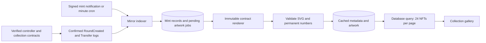

# NFT collection mirror

The public **NFTs** navigation opens `/collections`. Each collection has a stable `/collections/{chainId}/{contractAddress}` page. A page reads at most 24 NFTs; `?page=2` performs a new bounded database query. Collection browsing is also paginated. Cards display the stored contract-generated SVG, its four permanent numbers, and OpenSea links on Mainnet or Blockscout links on Sepolia. OpenSea [no longer supports testnets](https://support.opensea.io/en/articles/11833955-farewell-testnets).

This is a read-only projection of minted NFTs. Browsing does not call an RPC provider or populate the cache. The database never determines who can mint, claim a prize, receive holder rewards or request a refund. There is deliberately no cached owner or final-score claim in this gallery. Transfer history and current ownership remain available through each NFT's external link.

## Genesis collection

The directory has a dedicated **Tincta Genesis** section above paid season collections. Its stable collection page uses the same 24-NFT pagination and confirmed mint-event mirror. Genesis artwork is read from the verified free-mint contract's `tokenURI`, validated as passive SVG, and cached verbatim. Browsing remains database-only. An unminted collection shows the approved preview explicitly labeled as a preview; confirmed mints waiting for artwork show syncing, never invented tokens.

Migration 035 adds an explicit collection/token kind. Genesis uses a projection-only round ID of zero, outside paid catalog counts, with no four-number identity or combination code. A composite foreign key prevents mixed collection/token kinds. Paid NFT constraints, reorg handling and historical rows remain intact. V14 Indexer sources additionally require the exact `genesisCodeHash`; adding the pin replays only that source from its verified starting block. The chain reader validates Genesis's controller/voting bindings, runtime hash and immutable supply/window before admitting its confirmed mint events. Free NFTs never gain paid-season financial entitlements from gallery display.

The user-facing copy says Genesis votes only in the first paid ballot; later voting needs successfully revealed paid-season NFTs. No prize, affiliate, sponsored mint or holder reward controls are exposed for Genesis.

## Event and artwork flow

The controller runtime hash, chain ID, contract generation and `rounds(roundId)` registration are verified. Collection voting and renderer bindings must match the controller. Discovery records immutable appearance only: the permanent combination key is read after the mint, because supply is selected through voting. The key is checked against the chain, collection, round, season and voted supply domain. Identity numbers are derived with the same reviewed permutation and compared with the renderer metadata.

Both V12 and V13 use `ManekinekoRendererV11`. Its output still truthfully identifies its original renderer lineage internally; the public UI contains no release labels. Calling that same immutable renderer preserves byte-identical artwork even when `round.tokenURI()` can no longer serve an NFT burned for a refund. Confirmed zero-address mint events are required before any artwork job is created. Secondary transfers do not create additional records. Burns update the retained mint record and display **Refunded · Burned**.

Confirmed event ingestion and its cursor commit atomically. Artwork caching is a durable second step: failed reads keep their queued record, use bounded retry delays and never become fabricated artwork or zero numbers. Repeated events and repeated invocations cannot duplicate NFTs. A source lease prevents concurrent cron/webhook writes; an expired worker cannot commit after takeover. The current collection is scanned first, followed by older collections in rotation. Each invocation is time bounded and uses the existing RPC pacer; historical catch-up and artwork queues may require multiple invocations.

A source anchor covers all committed observations. An anchor reorganization clears its derived collection/token rows and replays from the configured start. Collection cursor checks also remove orphaned NFTs before replay. Hashes are rechecked inside checkpoint/cache transactions. Trust or canonicality failures hide that source until verified again; ordinary provider failures preserve the previous mirror and its displayed sync time. The UI distinguishes available artwork, artwork still syncing and collections without confirmed mints.

## Configuration and release order

1. Inspect the target database identity and migration ledger. Apply migrations `033_nft_mirror.sql`, `034_genesis_v14_mirror.sql` and `035_genesis_nft_gallery.sql` through the normal migration process. It adds only three projection tables and indexes; it does not alter historical identities, frozen plans or chain contracts. Never seed a hosted database for verification.
2. Grant the Web runtime **SELECT only** on `manekineko_nft_mirror_sources`, `manekineko_nft_mirror_collections` and `manekineko_nft_mirror_tokens`. Grant Indexer SELECT/INSERT/UPDATE/DELETE on those tables. The existing staging provisioning scripts include these grants. The Indexer also needs its existing authenticated webhook delivery table. Review the scripts' target/grant scope before using them against hosting.
3. Configure server-only `NFT_MIRROR_SOURCES_JSON` on Indexer. This is an array of up to four profiles with `chainId` (1 or 11155111), `controller`, exact `codeHash`, controller `version` (12, 13 or 14), private HTTPS `rpcUrl`, and `fromBlock`. V14 also requires `genesisCodeHash`. Use the controller deployment block or earlier; the reader rejects a start after the controller already existed. Historical `eth_getCode`, `eth_getLogs` and `eth_call` access is required. Optional `confirmations` defaults to 12 on Mainnet and 2 on Sepolia and cannot be lower. Optional `blockRange` defaults to 2000 and is bounded to 1–2000. Never use a private RPC URL in a public environment variable.
4. Web defaults to its current public controller pins. For additional historical current-protocol controllers, set server-only `NFT_MIRROR_CONTROLLERS_JSON` to the reviewed `{chainId,controller,codeHash,version}` allowlist. It must match indexed sources. Removed or repinned controllers are not silently admitted. Legacy V5–V11 factory collections are outside this new controller projection and are not relabeled or restored.
5. Deploy Indexer and Web. The minute cron `/api/indexer/nfts` uses the existing `CRON_SECRET`. It returns `not_configured` when the mirror is disabled, and returns a retryable response while catching up. Existing legacy indexing and marketplace refresh crons remain independent.
6. Optionally register a separate QuickNode delivery to `/api/indexer/nfts/webhook` using `QUICKNODE_NFT_MIRROR_WEBHOOK_SECRET`. Include controller creations and mint/burn transfers from its current/new collections in the provider's notification coverage. Signed payloads only trigger canonical reads; payload contents never write NFT records directly. Deliveries are deduplicated, and incomplete catch-up remains retryable. Cron provides catch-up if delivery is missed or confirmation depth has not yet been reached.
7. Allow the initial backfill to finish and verify a real collection's database count, cached image/numbers, pagination and external links against confirmed chain data. Report hosted persistence, cron/webhook delivery, browser acceptance and live-wallet operations separately. No wallet transaction is needed to view a gallery.

A release with no configured controller can publish the gallery shell before activation: the directory returns its preparation state without querying the database, and the cron returns `not_configured`. Keep both mirror source configuration and public controller pins unset until the migration, grants and actual deployed controller are ready. This state is not evidence of a working live mirror or a completed backfill.

## Local validation

`apps/indexer/test/nft-mirror.test.ts` uses migration 033 in a disposable localhost schema. It checks leases, atomic rollback, repeated events, caching/retries, burn labels, reorg removal, trust failures and 24/24/1 database pagination. `apps/contracts/test/NftMirror.ts` runs both current contract generations locally and compares the cached renderer response and numbers against `tokenURI()`/`combination()`, including a transferred then refunded NFT. The existing strict metadata/SVG suite covers malformed or active content.

`scripts/verify-nft-mirror-web.mjs` serves the real production build against an isolated schema and SELECT-only role. It verifies actual SSR pagination, hyperlinks and invalid-route boundaries. It accepts only `TEST_NFT_MIRROR_DATABASE_URL` on localhost; run with `node --import tsx` after building Web. It removes its schema/role and stops its server when finished.

`tests/visual/nft-mirror.spec.ts` imports production components/styles into the isolated browser harness. It covers image rendering, numbers, pagination, links, pending/empty/loading/error/retry states, responsive widths, enlarged text and accessibility. Browser fixtures are synthetic; they are not hosted or live-wallet evidence.

Local verification on 2026-10-24: Web and Indexer production builds passed; contract and UI typechecks passed. Indexer passed 90 tests with isolated SQL cases enabled. Web passed 297 tests with three pre-existing optional SQL cases skipped; the new mirror SQL and real SSR checks ran separately and passed. Both contract integration cases passed. Gallery and compact-header/docs browser checks passed 43 cases across Chromium, Firefox and WebKit, with eight deliberately omitted duplicate viewport cases. Desktop/mobile artwork screenshots were inspected. The provisioning check also caught a missing explicit archive-tombstone read grant, and the older automation test fixture needed migration 030; both are corrected. No hosted database migration, source configuration, backfill, cron/webhook delivery or deployment was performed in this implementation turn.

Release setup on 2026-10-24: after the user restored Neon capacity, migration 033 was applied to the identity-verified staging database. The migration ledger and existing checksums were checked first; 033 was the only pending migration. Actual runtime connections verified Web SELECT-only and Indexer SELECT/INSERT/UPDATE/DELETE access on all three mirror tables. Full `npm run check` passed, including 467 contract cases and all workspace builds/typechecks. Hosting has no current-protocol controller pins, so source activation and real NFT backfill await a verified deployed controller. Historical archived collections are not restored by this release.

## V14 Genesis release

Migration 034 extends only the controller-version constraint to include V14. Existing rows retain their recorded versions. V14 discovers its actual V13 paid rounds, with the same V11 metadata renderer; it never relabels these contracts as V14. The free Genesis collection remains outside paid-season accounting and the four-number ticket model. Migration 035 adds its separate section and paginated minted-artwork gallery alongside season collections. Web and Indexer must both receive the new controller pins after the migration.

The migration was exercised in a disposable local PostgreSQL database: versions 12, 13 and 14 were accepted and version 15 was rejected. The V14 contract integration case checks actual discovery, immutable metadata, transfers and refunds.

### Genesis gallery validation · 2026-10-26

The migration was exercised in a new disposable localhost database, including kind/FK rejection and 24/24/1 pagination; it was then applied as the only pending migration to the identity-verified Sepolia database. Three real-contract integration cases passed for V12/V13/V14, including exact Genesis tokenURI artwork and a wrong Genesis hash rejection. Web and Indexer builds/typechecks passed, as did their unit suites (optional unrelated database cases remained skipped). The gallery Opera suite passed 13 cases; its two intermediate-width paid-gallery cases were explicitly skipped by the existing viewport sampler. Genesis has mobile/desktop layout, accessibility, pagination, empty and syncing coverage. Live backfill and hosted verification are recorded separately from these local results.
